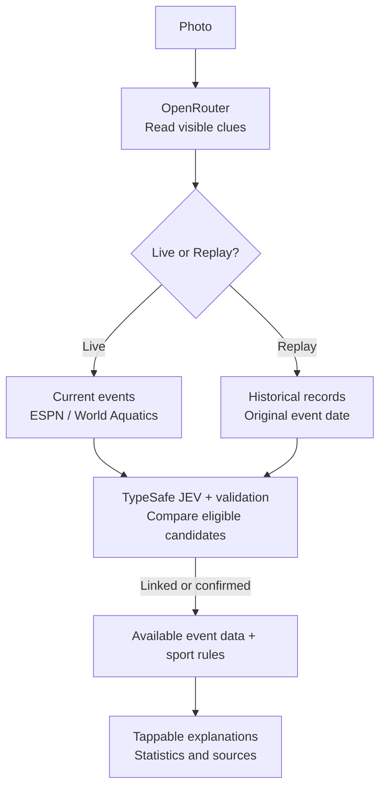

# Matchlight

## Intro

Matchlight helps spectators understand the game in front of them. Take or upload a photo of a sports broadcast or venue, connect it to an event, and tap markers on the photo to see scores, context, and explanations.

[Try the prototype](https://matchlight-eng170.uclae2e12.chatgpt.site/) — ChatGPT sign-in required.

## How It Works

A photo supplies clues. Sports feeds supply event facts. Matchlight connects the two and explains useful details on the image.

## Process

1. Take a photo or upload an image. Keep the scoreboard and participant names visible when possible.
2. Use **Live now** for a current broadcast, or select **Replay / past event** and enter the original event date.
3. Run the analysis and choose a matching event if prompted.
4. Tap the photo markers, then open **Match statistics** and **Sources** for more detail.

For a quick demo, choose **Current match sample**, a scorecard generated from current ESPN data. Historical samples open in Replay mode.

## Photo Analysis

The browser resizes photos to at most 1600px. Upload starts only when you run analysis.

- **Match checks:** Live queries use server time and explicit in-progress states. Conflicting clues block association. Unclear results need confirmation. Source failures stay separate from empty results.
- **Evidence:** Recorded facts and timestamps stay authoritative. The photo's score and the provider's latest score are shown separately.
- **Privacy:** Images go to the app server and OpenRouter. JEV and sports feeds receive clues, candidates, or queries. The app does not log or save photos. Keys stay server-side. Provider retention terms apply.

More detail: [analysis contract](docs/photo-analysis.md) and [JEV decisions](docs/jev-provider.md).

## Can Dos (Current Prototype)

- Extract the sport and readable clues from an uploaded photo.
- Look up in-progress events in supported ESPN competitions, including NBA and cricket, and connected World Aquatics feeds.
- Show available scores, competitors, countries, player statistics, and scoring breakdowns with their sources.
- Explain basic rules and selected recorded scores, including diving score calculations.
- Keep live and historical results separate, and distinguish an uncertain match, no current results, and an unavailable data source.
- Offer English and Chinese interfaces with mobile layouts.

## Can't Dos (Current Prototype)

- Identify every match from incomplete, blurred, or old photos.
- Prove photo identity just because only one compatible current event exists.
- Identify any athlete by face alone or confirm an exact play or dive without matching records.
- Guarantee complete statistics, instant updates, or coverage of every competition, including full Olympic or LA28 live coverage.
- Explain a judge's reason for a deduction without a supporting record.
- Watch continuous video or automatically follow every play.

## Stack

| Layer | Technology |
| --- | --- |
| Interface | React 19, Kumo UI, Phosphor icons |
| App and backend | Vinext / Vite with Next-compatible route handlers |
| AI services | OpenRouter vision models, TypeSafe JEV decisions |
| Sports data | ESPN and World Aquatics public feeds |
| Hosting | Cloudflare Worker through Sites |
| Validation | TypeScript and the Node.js test runner |

## Feature Branches

`main` is the integration branch. Feature branches organize development by module.

| Branch | Responsibility |
| --- | --- |
| `feat/spectator-ui` | Initial viewer, reusable components, and bilingual layouts |
| `feat/match-data-explanations` | Match records, scoring functions, and explanation APIs |
| `feat/visual-assets` | Generated illustrations, favicon, and asset provenance |
| `feat/ai-explanations` | Optional grounded explanations and fallback behavior |
| `feat/mvp-integration` | Dependencies, integration, verification, and deployment |
| `feat/athlete-media` | Official athlete portraits and identity mapping |
| `feat/la28-sports-theme` | Sports visual theme and portrait presentation |
| `feat/photo-scene-assets` | Verified competition photograph and provenance |
| `feat/photo-context-model` | Labeled sample context and manual clue validation |
| `feat/camera-first-prototype` | Camera entry, photo markers, and contextual cards |
| `feat/live-photo-agent` | Vision, decision, and event-data orchestration |
| `feat/live-photo-ui` | Upload analysis, dynamic markers, and confirmation UI |
| `feat/espn-provider` | Allowlisted ESPN event lookup tools |
| `feat/jev-decision` | TypeSafe decision adapter and response validation |
| `feat/espn-five-sport` | ESPN Olympic results and current cricket adapters |
| `feat/world-aquatics-provider` | Official aquatic results and scoring records |
| `feat/olympic-archive` | Public Paris 2024 fallback records |
| `feat/five-sport-ui` | Individual results, countries, and athlete cards |
| `feat/five-sport-integration` | Cross-sport matching, rules, and end-to-end verification |
| `feat/live-event-discovery` | Current-event discovery, association checks, and statistics |
| `feat/live-discovery-ui` | Live / Replay controls and current-event result states |
| `feat/current-aquatics` | Current World Aquatics discovery and phase-status checks |
| `feat/current-olympics` | Limited current-day ESPN Olympic lookup |
