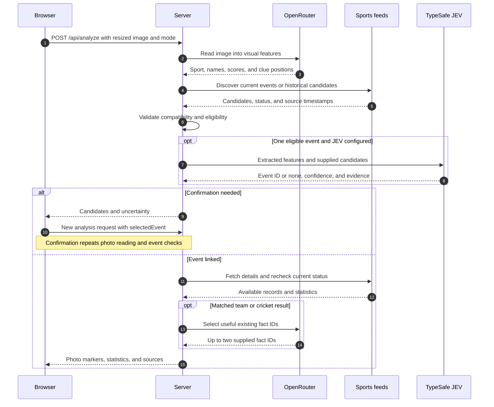
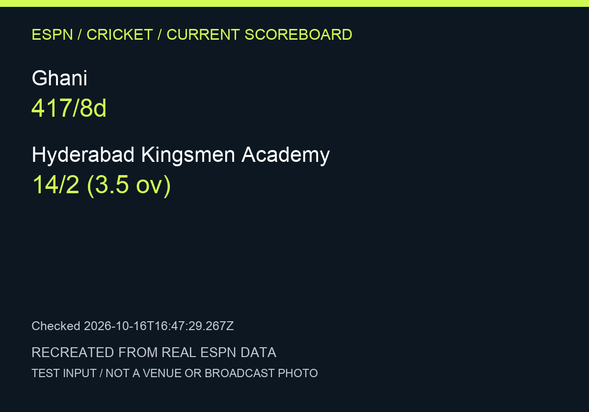
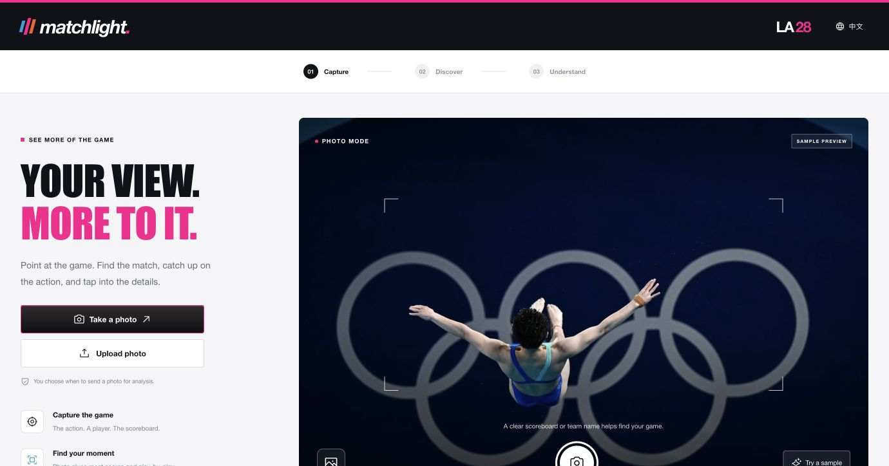
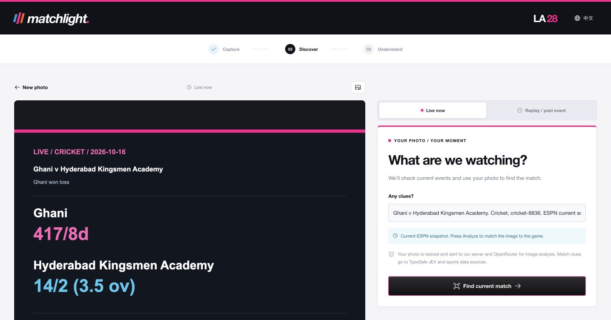
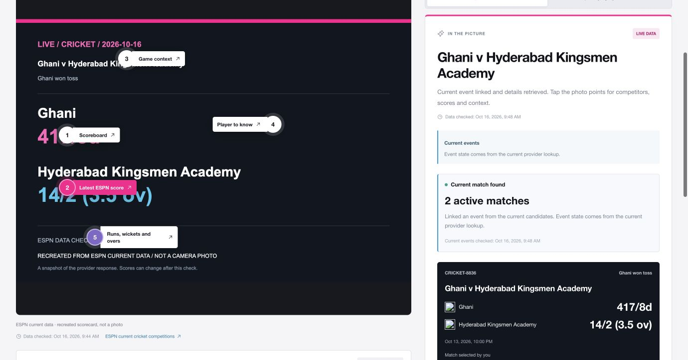
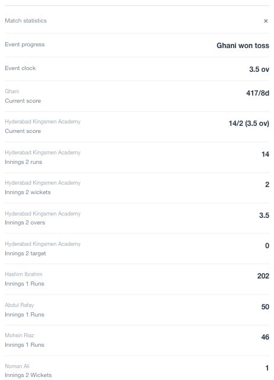
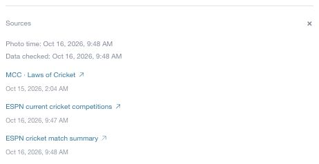
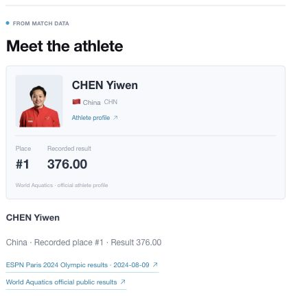
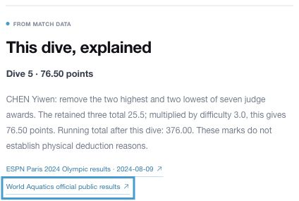

# Runtime walkthrough

Verified against the deployed private prototype on **October 16, 2026, America/Los_Angeles**. The runs used real model and sports-data requests. Recreated scorecards are explicitly labeled and are not venue or broadcast photographs.

## Request sequence

The browser sends `mode`, `imageDataUrl`, `capturedAt`, `timeZone`, `locale`, and optional clues or a selected event. The response includes extracted features, association state, available event data, photo points, sources, model names, and a short stage trace.

The backend owns a fixed provider registry. Models do not supply fetch URLs. API-source details are documented [separately](api-sources.md).

## Matching principles

| Question | How the prototype answers it |
| --- | --- |
| What is visible? | OpenRouter reads supported clues and returns structured JSON. Faces alone cannot establish athlete identity. |
| What is happening now? | Live uses server time, recent event timestamps, and explicit provider in-progress status. An upload date does not make an old event live. |
| Which event fits? | Code rejects conflicts before accepting a model decision. A sole compatible current event can provide context. Several candidates need distinguishing clues or confirmation. |
| What about a replay? | Replay searches the original event date and requires stronger printed identity and event evidence. It can use the Paris archive fallback. |
| Which exact action is pictured? | This needs separate recorded evidence. Shared clock readings, a final score, or a familiar athlete are insufficient. |
| Where do explanations come from? | Provider records and source-linked rules. The team-sport model selects fact IDs. Code preserves the actual values, wording, timestamps, and score calculations. |

Photos are resized to at most 1600px and uploaded after analysis starts. The app does not log or save photo bytes. JEV and sports feeds receive features, candidates, or queries. Keys remain server-side. External provider retention terms apply.

## Backend run: current cricket

At approximately **9:47 AM PDT**, the current cricket endpoint returned two in-progress events. The test rendered a labeled PNG from one returned event and submitted it to the production `/api/analyze` endpoint without a manual selection.

This image is a documentation test fixture. It is separate from the browser's built-in sample below.

| Stage | Actual result |
| --- | --- |
| Vision | `google/gemini-3-flash-preview` extracted cricket and the visible teams and scores |
| Discovery | Two current candidates, no failed provider in this lookup |
| Decision | `jev-1.13.0` selected event `1553797` and passed the code's thresholds |
| Detail | ESPN summary for Ghani v Hyderabad Kingsmen Academy |
| Fact selection | `google/gemini-3-flash-preview` selected existing facts |
| Response | `matched`, `temporal: live`, `matchMethod: current`, 19 statistics, five photo points |

The points were Scoreboard, Latest ESPN score, Game context, Player to know, and Runs, wickets and overs. The exact photographed action remained unconfirmed.

The [recorded JSON response](examples/2026-10-16-live-run.json) contains the extracted features, returned statistics, sources, model names, and stage trace. It contains no API keys, authorization headers, or uploaded image bytes.

## Browser run: capture, confirm, explore

1. Open the prototype and choose a language before analysis.
2. Select **Current match sample**. The app queries ESPN and creates a local scorecard.
3. Press **Find current match**. In this run the app asked for candidate confirmation.
4. Select **Ghani v Hyderabad Kingsmen Academy**, matching the visible scorecard.
5. Open the score marker, **Match statistics**, and **Sources**.

The entry photograph is a historical diving image credited to Tsutomu Kishimoto / World Aquatics. It is a preview, not evidence for the current cricket event.

The browser returned 19 statistics and five points. Its confirmation step differs from the automatic backend test. A model-assisted association can remain uncertain even with a recreated scorecard.

| Statistics detail | Source detail |
| --- | --- |
|  |  |

The detail panels are cropped for readability. The full browser result appears above. The source panel separates the rule reference from the ESPN discovery and match-summary retrieval times.

## Browser run: historical diving

Select **Diving · 3m final**. The app selects Replay and fills the original date. Press **Analyze photo**, then open **Meet the athlete** and **This dive, explained**.

The actual run matched the Paris 2024 women's 3m springboard final. ESPN results were enriched with compatible World Aquatics records, including all 12 finalists and the official dive details. It remained labeled **HISTORICAL**.

| Athlete detail | Recorded dive calculation |
| --- | --- |
|  |  |

The printed CHEN Yiwen name established the athlete clue. Her face was not used to identify her. The calculation was **25.5 retained judge points × 3.0 difficulty = 76.50**, with a running total of 376.00.

The [full historical result screenshot](images/07-replay-athlete-full.jpg) includes the recreated input, event result, athlete card, and calculation.

## Model calls per request

| Path | OpenRouter calls | JEV calls |
| --- | ---: | ---: |
| Matched team or cricket event | 2 | 0 or 1 |
| Matched individual event | 1 | 0 or 1 |
| Empty, unavailable, unsupported, or unresolved discovery | Usually 1 | 0 or 1 |
| Manual confirmation | New request, including photo reading | 0 |

JEV is optional in configuration. With it configured, live automatic association invokes it only when one event is independently eligible. One JEV request contains both Choice and evidence assessment. Failed fact selection keeps verified fallback cards. Failed vision stops analysis. Missing OpenRouter configuration returns `503 NOT_CONFIGURED` before a model call.

## Observed limits

- Current diving lookup returned no confirmed in-progress event. The successful diving demonstration used historical records.
- Two ESPN team-logo images failed to load in the cricket browser capture. The scorecard, names, scores, statistics, and source links remained available.
- Data availability and model decisions can change between runs. Returned fields may be incomplete or contain upstream placeholders.
- Physical phone camera capture was not exercised. These runs used the built-in browser samples and a generated public-data PNG.
- The prototype processes one image per request. It does not continuously watch video or guarantee the exact photographed play.

[Back to README](../README.md) · [API sources](api-sources.md)
